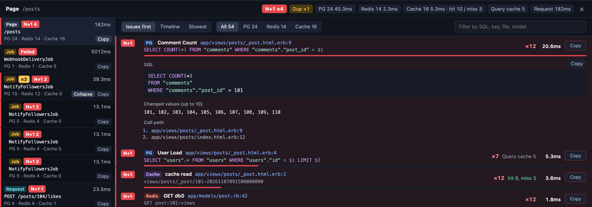
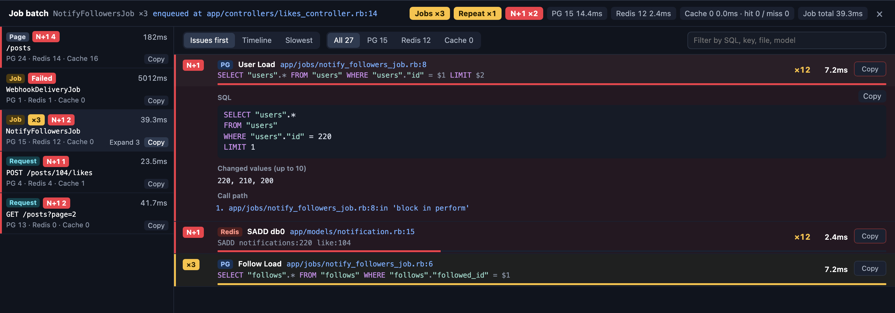

# roundtrips





A development-only panel for Rails. Open any page and a badge appears in the bottom-left corner. Click it to see every **round trip** that request made to your data stores.

- Collects PostgreSQL queries, Redis commands and Rails cache calls, each with the line of app code that made it (`file:line`).
- Flags calls repeated from the same call path with different values as `N+1`, and calls repeated with the same values as `Dup`.
- Groups the async requests (Turbo Frames, fetch, form submits) and Sidekiq jobs started from that page under it.
- Every row has a `Copy` button that turns the SQL, changed values and call path into text you can paste into a prompt.

The UI is available in English and Korean.

## Installation

```ruby
# Gemfile
group :development do
  gem "roundtrips", github: "astrocket/roundtrips", branch: "main"
end
```

Run `bundle install` and restart the server. The middleware is only added in development; in other environments the gem does nothing.

To turn it off, start the server with `ROUNDTRIPS=0`, for example `ROUNDTRIPS=0 bin/dev`.

## Configuration

```ruby
# config/initializers/roundtrips.rb
if defined?(Roundtrips)
  Roundtrips.configure do |config|
    # Paths that should never get the panel (e.g. pages you take screenshots of)
    config.ignored_paths << %r{/captures(/|\z)}
    # Code to skip when finding the call site (e.g. middleware every request goes through)
    config.ignored_frames << %r{\Aapp/middleware/}
    # UI language: "en" or "ko"
    config.locale = "en"
  end
end
```

| Option | Default |
|---|---|
| `ignored_paths` | `/vite-dev`, `/vite-test`, `/assets`, `/packs`, `/cable`, `/rails/active_storage` |
| `ignored_frames` | `config/` |
| `locale` | `"ko"` if the app's `I18n.default_locale` is Korean, otherwise `"en"` |
| `enabled` | `true` unless `ROUNDTRIPS=0` |

## How it works

- Subscribes to `sql.active_record` and `cache_*.active_support` events, and records Redis commands through `RedisClient.register`. Sidekiq, the Rails cache and `Redis.new` all go through redis-client.
- For the request that renders a page, the panel is inserted right before `</body>`.
- Async requests and Sidekiq jobs run in other processes, so they are written to `tmp/roundtrips` and the panel fetches them from `/__roundtrips/events`. Records older than 30 minutes are deleted.
- A Sidekiq client middleware adds the enqueuing request and call site to the job payload (`roundtrips_*`), so jobs can be grouped under the page that started them.

## Safety

- The panel is only added for requests to `localhost`, `127.0.0.1` or `*.localhost`. If you expose your dev server through a tunnel (ngrok etc.), visitors never see your SQL or bind values.
- 500 responses, non-HTML responses and file responses are left untouched.
- Conditional request headers are removed so a 304 never leaves you with a page without the panel.

## Limitations

- SQL with filled-in values only fills PostgreSQL-style `$1` binds.
- Job grouping only works with Sidekiq. Other Active Job adapters are not recorded.

## Development

```sh
bundle install
bundle exec rspec
```

To work on the gem while using it from an app, point the app at your local checkout. This requires the app's Gemfile to reference the gem with `branch:` (Bundler rejects local overrides for `tag:`).

```sh
bundle config set --local local.roundtrips ../roundtrips
```

While the override is on, `Gemfile.lock` records your local commit. After pushing the gem, run `bundle config unset --local local.roundtrips && bundle update roundtrips` to lock the pushed commit, then commit the lockfile.

## License

MIT
